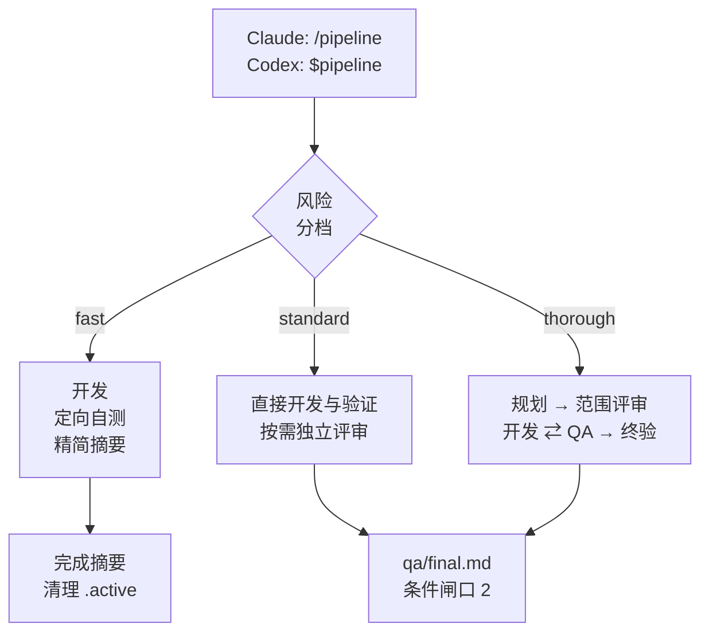
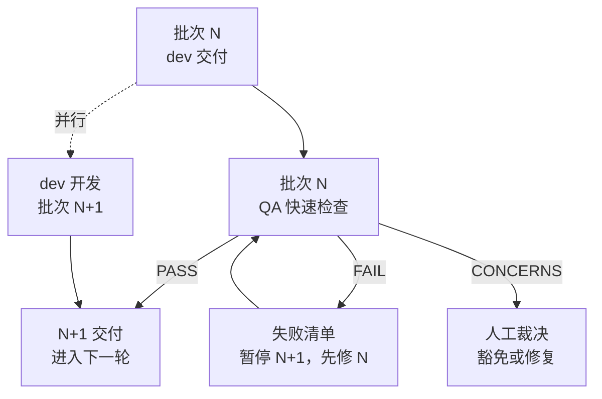

# pipeline-standard — 通用研发流水线标准


端到端「需求 → 开发 → 测试 → 上线」多角色流水线，同时原生支持 **Claude Code** 与 **Codex**；方法论通用，项目差异由项目根的 `PIPELINE.md` 契约注入。

**直接说需求，不用手填配置。** 安装后在项目会话输入 `$pipeline 帮我实现……`（Claude Code 用 `/pipeline`），智能体识别项目、补全接入信息并选择合适流程。缺少关键业务信息时才提问。

| 你想做什么 | 直接这样说（Codex 示例） |
| --- | --- |
| 开始开发 | `$pipeline 给列表增加搜索功能` |
| 先接入项目 | `$pipeline 帮我初始化` |
| 选择模型 | `$pipeline 配置模型` |
| 一句话设置角色 | `$pipeline 开发继承当前模型，架构让我从可用模型中选` |
| 修改/查看 | `$pipeline 测试恢复继承` / `$pipeline 查看设置` |
| 继续/查进度 | `$pipeline 继续上次` / `$pipeline 进度怎么样` |
| 修复中断 | `$pipeline 帮我修复中断状态` |

模型默认只保存当前项目、当前运行时，另一端配置保留；说“所有项目通用”才保存个人默认，说“只这次”则不持久化。未配置沿用原默认，不要求完成问卷。角色偏好只在实际委派时应用；主会话直通仍使用会话模型，智能体会说明生效范围。可用模型与推理强度以当前宿主为准，不支持时不会静默替换。文档中的具体型号仅是示例，不代表你的账号拥有权限；无法获取可用名单时，可以直接选择“继承当前模型”。

| 运行时 | 触发方式 | 原生能力 |
| --- | --- | --- |
| Claude Code | `/pipeline <任务描述>` | 注册角色、批次并行、team 直聊、`PreToolUse` 禁区硬拦截 |
| Codex | `$pipeline <任务描述>` | 子 agent 编排、批次并行、follow-up 续跑、`PIPELINE.md` 写前校验 |
| 其他 agentic 工具 | 便携模板 | 单 agent 串行执行核心流程 |

## 组成

```text
agents/                     5 个通用角色(Claude Code 注册；Codex 以任务模板派发)
  pipeline-scope-guardian   A 范围守门员(只读):审计划、验收,对照需求基线与规范
  pipeline-planner          B 任务拆解员:先澄清歧义,再拆成带验收标准的任务清单
  pipeline-developer        C 开发工程师:只按计划做,checkbox 追踪进度
  pipeline-tester           D 测试工程师:实测 + 对抗式找茬,gate 三态结论,只报不改
  pipeline-releaser         E 发布工程师:thorough 或自动提交时启用,默认不动 git/不部署
skills/pipeline/SKILL.md    双端 skill：Claude `/pipeline`、Codex `$pipeline`
skills/pipeline/references/ 按档流程、QA、依赖和恢复说明(按需加载)
hooks/pipeline-guard.sh     禁区硬拦截 hook(PreToolUse),流水线运行期间生效
templates/PIPELINE.md       项目契约模板(❏ 占位符)
templates/single-agent-pipeline.md  便携版:单 agent 顺序执行全流程(无子 agent 工具用)
install.sh                  双端安装/同步脚本(Claude agents/hooks + Claude/Codex skills)
init-project.sh             项目接入脚本(拷契约模板 + 配 hook + gitignore,幂等)
```

## 流程

主流程(v3.9.0 对话式入口、按需编排):



第 3 步的批次级并行循环(qa 测上一批与 dev 开下一批墙钟重叠):



## 流程特性

### 核心流程

- **澄清前置**:planner 发现实质性歧义先提问,不带着猜测拆计划
- **三档分流**:`fast` 用于内聚、可定向验证且无依赖/API/安全风险的明确改动，不按文件数限制；`standard`(默认)由当前 agent 直接规划、开发和验证，独立评审与子 agent 按风险和收益启用；`thorough` 保留五角色、两道闸口与里程碑拆分。用户可用 `--fast` / `--standard` / `--thorough` 指定，系统只会自动升级，不会自动降级。
- **批次级循环**:standard 默认单批；有独立交付和验证收益时才拆批并委派。仅不影响测试现场的开发可与 QA 重叠；共享工作树全量测试期间暂停写入，单批打回 ≤3 轮。
- **team 直聊**:开发⇄测试打回循环由两个 teammate 直接续跑对话，调度员只监控轮次与裁决，不经手中转(省上下文；异常时回退中转模式)
- **条件闸口 1**:里程碑、风险信号或未授权任务必须人工确认；契约允许「低风险自动进入开发」或用户给 `--auto` 时，标准计划发简报后直接进入开发，避免长时间空等。
- **QA gate 三态(批次级快速检查)**:`PASS / CONCERNS / FAIL`;批次级只覆盖本批核心路径,非核心项与跨批回归记录为「终验复核项」,不占用轮次
- **按档收口**:fast 只给精简摘要；standard 默认当前 agent 产出 `qa/final.md`，不生成交接包、plan、retro；需要委派时才建立交接文件。thorough 保留完整 acceptance/release/retro。
- **检查去重**:同一代码、配置、依赖与环境下的实际成功结果可复用，须保留命令、范围、时间、退出码和输出；失效或缺证据时重跑。核心验收和契约要求的检查仍必须覆盖。共享工作树全量测试期间暂停写入。
- **禁区保护**:Claude Code 的 hook 在 `/pipeline` 运行期间(存在 `tmp/pipeline/.active` 标记)按 PIPELINE.md ⑤ 的 `pipeline-guard` 块硬拦截越界 Write/Edit；Codex 在每次写入前对同一契约做流程校验
- **打回硬上限**:范围评审 ≤2 轮,测试 ≤3 轮,到顶停报

### 效率与成本

- **批次进度简报**:每批 gate 只发一行；表格式快照仅用于等待用户、预算预警和异常停止。
- **上下文瘦身**:plan 按批拆文件、demo/大文档按需切片检索,控制各角色冷启动读入量
- **渐进加载**:主 SKILL 只保留路由和硬边界，fast/standard/thorough、QA、依赖、恢复说明只在命中时加载。
- **共享上下文**:稳定项目内容写 `context/base.md` 并按来源指纹复用；每次只新建轻量 `context/run.md`，各角色再接收阶段差量。
- **验证分层**:每批只跑快速且受影响的检查，完整类型检查、构建、E2E、性能和扫描只在最后一批或终验运行一次；打回复测继续限定在修复影响面。
- **QA 报告压缩**:`qa/index.md` 只保存批次索引，`qa/<批次>.md` 仅保留当前轮全文与紧凑历史，终验默认不重读已 PASS 正文。
- **旧契约兼容**:未声明快速/终验分层时自动分类且不阻塞，全部原命令最多在收口运行一次。
- **复测收敛**:打回复测只覆盖修复项 + 影响面 + 快速命令层,首轮已过的重命令不重复跑——打回轮次不再烧全量 token
- **角色模型**:说“配置模型”即可按当前运行时保存偏好，委派时应用；未配置时保留原默认（Claude 的 tester/releaser 按角色 frontmatter，Codex 继承主会话）。配置不可用会说明，不静默替换。
- **Ponytail 编码纪律**:developer 遵循「最少代码原则」——优先复用现有实现/一行能解不写十行/不添加计划外抽象;测试、类型安全、可访问性、安全边界不许精简
- **ETA 自动校准**:planner 只读 metrics 最后 5 条同档记录；样本足够时用中位数/P80，不足时给低置信度阶段区间，不再采用固定每任务分钟系数。

### 可靠性与恢复

- **断点自恢复**:standard/thorough 维护 `tmp/pipeline/state.md`；fast 正常流程不写，只在异常时保存最小现场。
- **裁决分片**:只搜索 `rulings/index.md`，命中当前范围才读取 `rulings/<run-id>.md`，避免跨运行历史无限灌入上下文。
- **git 写操作默认硬边界**:releaser 及任何角色禁止执行 `git add/commit/push/tag`,除非 PIPELINE.md 第 ④ 节明确声明「自动提交」；默认闸口 2 由人类手工执行，建议命令位于本档摘要或 thorough 的 release-notes.md。
- **预算上限**:闸口 1 可设时长/批次上限,快照对照,≈80% 主动预警
- **skill 安全扫描**:声明式 skill 安装前扫描可疑模式(管道执行/外联/越权读写)，命中拒装转人工；Codex 在 clone 前还会请求授权
- **可选通知**:契约声明 webhook(URL 走环境变量)后,闸口等待/待裁决/完成三时机推送,未设静默跳过

### 复盘闭环

- **轻量度量**:每次只向 `metrics.tsv` 追加一行真实运行指标；token 不可见时留空。retro 保留定性偏差，planner 不全文扫描历史。

## Codex 原生模式与便携模式

Codex 支持本仓库的 `pipeline` skill：fast/standard 默认当前 agent 直接执行，需要独立评审或并行收益时才创建子 agent；thorough 保留完整编排。Claude Code 使用同样的默认策略。安装后新开 Codex 会话，使用 `$pipeline <任务描述>`。

Codex 与 Claude Code 共用三档路由、`PIPELINE.md`、角色规则、条件闸口、artifact 和打回上限。两端的唯一执行机制差异是 Claude Code 可通过 `.claude/settings.json` 的 `PreToolUse` hook 硬拦截越界写；Codex 当前改为每次写入前的 `PIPELINE.md` 强制校验，不能宣称具备同等级工具层拦截。Claude Code 保留契约声明的自动 CLI/skill 安装；Codex 对全局 CLI 安装、clone 外部 skill 等项目外写入会先请求授权。

若运行环境没有可用的子 agent，才使用下面的单 agent 便携模式。

流水线分三层，前两层与工具无关——**PIPELINE.md 契约**(纯 markdown)与**角色 prompt**(自然语言纪律)；便携版省去编排执行层。

`templates/single-agent-pipeline.md` 是便携版:同样按 fast/standard/thorough 分流，由单 agent 按需换装角色，拷到任意不支持子 agent/hook 的编码工具即可用(Gemini 自定义命令、Cursor 直接粘贴等)。方法论、条件闸口、批次循环和打回上限与主版一致。

原生多 agent 版相对便携版的优势：

- **真角色隔离**:每角色独立 subagent 冷启动,tester 看不到 dev 的实现思路,对抗式找茬是真对抗;便携版同一上下文,靠纪律模拟。
- **批次并行**:qa 测上一批与 dev 开下一批墙钟重叠;便携版只能串行。
- **打回直聊**:dev⇄qa 直接续跑消息，不经调度员转发完整上下文，节省上下文；便携版单上下文无此需求，但也失去上下文瘦身收益。
- **Claude Code 额外具备禁区硬拦截**:⑤ 白名单由 `PreToolUse` hook 机器执行。Codex 保留等价的流程校验，但当前不具备同一层级的 hook 接口。

## 使用

1. 安装(每台机器一次):`git clone` 本仓库后 `bash install.sh`(同时安装 Claude Code 与 Codex；可传 `--claude` 或 `--codex` 限定目标)。
2. 在项目会话直接说“帮我初始化”或描述需求，智能体自动维护 `PIPELINE.md`，不要求手填模板。已有项目规则会保留。
3. Claude Code 用 `/pipeline <任务描述>`；Codex 用 `$pipeline <任务描述>`。自动按风险选档，用户无需记参数；原有 `--fast`、`--standard`、`--thorough`、`--auto` 仍兼容。
4. 中间产物位于 `tmp/pipeline/`。standard 直通仅维护 state、qa/final.md 和 metrics；实际委派后才创建 context 与计划；thorough 保留完整产物。fast 正常结束只追加 metrics。所有档位运行期间维护 .active，单项目同时只跑一条。
5. 中断后说“继续上次”或“帮我修复中断状态”，智能体检查活动执行者并处理，不要自行删除锁文件。
6. Codex 使用原生 skill；没有子 agent/hook 的其他工具使用便携模式(见上节)。

## 角色工具箱(推荐)

通用层不硬编码任何工具——由项目契约 ③ 声明，只有进入实际使用该工具的测试层时才自检。Claude Code 可按契约自动安装缺失的全局 CLI；Codex 会先展示命令和影响并请求授权。求精不求多,每角色 1–2 个;`templates/PIPELINE.md` ③ 节有同份注释清单(含条件启用项)可直接启用。完整安装命令与场景说明见 [tools/quick-install.md](tools/quick-install.md),此处不再重复,避免多份文档不同步。

条件启用(只进模板注释,不进主表):knip(死代码扫描,项目体量大后)、size-limit(bundle 体积门禁,有体积验收条时)、npm audit(依赖漏洞,零安装)。

原则:日常批次 gate 只跑快反馈项(lint/typecheck/单测/E2E 冒烟),重工具(Lighthouse/fuzz/压测)声明为里程碑收口用,避免每次 run 都烧全量。

## 接入新项目

推荐直接在项目会话说 `$pipeline 帮我接入`（Claude Code 用 `/pipeline`）。以下脚本保留给自动化接入或高级用户：

```bash
bash init-project.sh /path/to/项目            # 双端/Claude Code 项目
bash init-project.sh --codex /path/to/项目    # Codex-only 项目，不创建 .claude 配置
```

脚本准备契约模板、gitignore 和对应端 hook；项目内容由后续对话自动识别补全。脚本单独运行不代表业务契约已配置完成。无需用户逐项替换占位符。

模型偏好由智能体保存到 `pipeline.models.json`，个人默认位于 `~/.config/pipeline-standard/models.json`；无需手动编辑。按“本次指定 > 项目 > 个人 > 原运行时默认”解析。查看设置会说明来源和是否实际启用。实现规则见 [对话入口](skills/pipeline/references/interaction.md) 和 [模型配置](skills/pipeline/references/models.md)。

## 最近更新

后续建设见 [分期开发路线图](docs/ROADMAP.md)：覆盖能力边界、角色模型可靠性、性能对照、对话操作、双端回归和真实项目试点，包含各期任务与验收标准。规划项不代表已实现。

当前落地与限制见 [实施记录](docs/IMPLEMENTATION.md)、[兼容矩阵](docs/COMPATIBILITY.md)。本地回归运行 `bash tests/run-all.sh`；真实模型验证和性能对照单独记录，不能由单元测试替代。hook 的 Bash 检查是启发式，并非完整沙箱。

- **v3.9.0**: 增加可靠模型配置保存、双端纯参数适配、运行归属与恢复、测试证据失效检查、A/B统计及本项目集成回归；修复hook合并与编辑路径边界。61项本地行为测试通过；真实双端模型应用、A/B提速和远端CI单独验收。详见 [发布说明](docs/releases/v3.9.0.md)。
- **v3.8.0**: 对话式项目接入、模型选择/修改/继承、状态查询与续跑；智能体维护配置，Codex/Claude 偏好分离，按需委派时校验应用。保留旧参数与默认直通路径。
- **v3.7.0**: fast/standard 默认当前会话直接执行；移除 fast 文件数门槛，交接包和独立角色按需创建；复用未失效的真实测试结果，单批合并 QA 与终验。保留高风险审查、契约边界和必需验证。尚无同任务前后对照数据，不承诺固定耗时或 token 降幅。
- **v3.6.1**: 固定 token 进一步收敛——主 SKILL 渐进披露、共享 context base + 角色差量、裁决按 run 分片、轻量 metrics 与中位数/P80 ETA；Claude、Codex、便携模式同步。
- **v3.6.0**: 性能与 token 收敛——三档独立执行链、旧契约无阻塞测试分层、QA 索引/批次报告压缩、惰性 skill 自检、standard 条件角色与 fast 最小 artifact；Claude Code、Codex、便携模式同步。
- **v3.5.3**: v3.5.2 review 补丁——hook 拦截 Bash 层 git 写操作 / init-project 自动配置 Bash PreToolUse / state.md 五要素示例 / 闸口 1 与便携版双口径 ETA 展示细化
- **v3.5.2**: M1 实战补强——git 写操作硬边界 / 跨会话裁决一致性(rulings.md) / mock 基础设施端点豁免 / init-project 默认 gitignore 守护 / retro 校准 ETA 双口径
- **v3.5.1**: developer 角色引入 Ponytail 编码纪律（最少代码原则）
- **v3.5**: P1 四件套——state.md 断点自恢复 / skill 克隆安全扫描 / 可选 webhook 通知 / 预算上限
- **v3.4**: P0 三件套——复测范围收敛 / retro.md 复盘闭环 / 模型分级（tester=sonnet, releaser=haiku）
- **v3.3**: 便携模式（单 agent 降级版）+ README 流程图

## License

MIT
