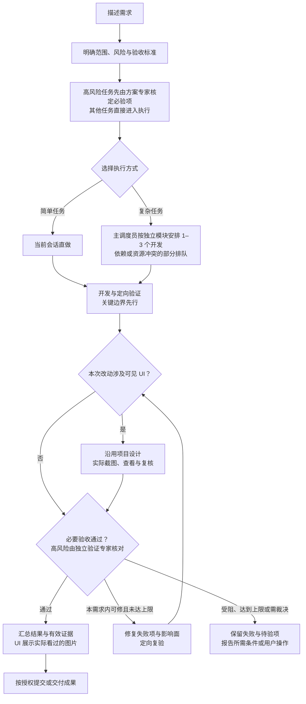
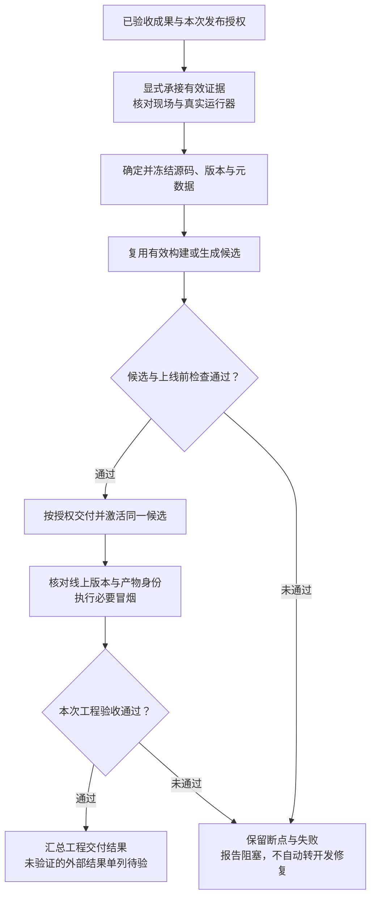

# pipeline-standard

[English](docs/README.en.md) · 简体中文


[](https://github.com/wzm111/pipeline-standard/actions/workflows/test.yml)

**用对话完成需求、开发、测试和交付，支持 Claude Code 与 Codex。**

pipeline 是一套由编码智能体执行的 skill 和本地工具。你描述需求，智能体明确范围与验收标准，按复杂度选择直接实现或必要的角色协作，并记录可核验的执行证据。项目差异由智能体维护的 `PIPELINE.md` 承载，无需先填写配置、选择流程档位或学习内部命令。

- **控制范围**：只做当前需求和必要配套，发现无关问题先记录。
- **看清过程**：展示当前动作、有效结果、剩余步骤和阻塞，区分执行结束与交付完成。
- **复用证据**：输入、环境、日志和来源仍有效时复用检查，保留必要复测。
- **视觉自查**：页面任务沿用项目设计，记录实际截图、查看与复核；缺少真实观察时保留待验。
- **本地诊断**：运行记录可在本地预览，诊断模块不自动上传报告。

[快速试用](docs/TRY-PIPELINE.md) · [稳定版 v3.14.0](https://github.com/wzm111/pipeline-standard/releases/tag/v3.14.0)

## 三步开始

### 1. 安装

本机需要 Git 和 Python 3；仓库 CI 使用 Python 3.11。在终端执行，或让智能体协助安装：

```bash
git clone https://github.com/wzm111/pipeline-standard.git
cd pipeline-standard
bash install.sh
```

默认同时安装 Claude Code 和 Codex；仅安装一端可用 `bash install.sh --claude` 或 `bash install.sh --codex`。

安装器将 skill 链接到当前仓库，并为 Claude 准备角色和 hook 链接，请保留仓库目录。首次安装准备本机默认模型配置；重装保留已有选择。上述命令安装当前默认分支的内容，需要固定版本时可让智能体切换到指定发布标签。

当前推荐完整仓库安装：`agents/`、`hooks/`、模板和脚本共同组成工具。只复制 `SKILL.md` 或 `skills/pipeline/` 不能视为完整安装；第三方目录的一键安装、官方插件商店上架尚未作为已验证能力提供。

### 2. 在业务项目会话中描述需求

**Codex：**

```text
$pipeline 给列表增加搜索功能，并验证空结果和清空搜索的行为
```

**Claude Code：**

```text
/pipeline 给列表增加搜索功能，并验证空结果和清空搜索的行为
```

缺少项目契约时，智能体识别项目并补齐 `PIPELINE.md`，保留已有规则；只询问无法推断且影响结果的关键信息。每个需求只做当前目标及必要配套，无关问题不自动加入开发或验收。

### 3. 用自然语言继续

| 你想做什么 | Codex 示例 |
| --- | --- |
| 梳理需求 | `$pipeline 梳理批量核销需求，先讨论，不改代码` |
| 整理方案 | `$pipeline 把已确认的方案保存为本地文档，列出验收条件` |
| 拆分任务 | `$pipeline 按可独立验收的业务结果拆分方案，标明依赖` |
| 按方案开发 | `$pipeline 完成任务 03，本轮先验证，暂不提交` |
| 审查代码 | `$pipeline 审查从 <SHA> 到 HEAD 的改动，需求见 <路径>，只报告问题` |
| 核验功能工单 | `$pipeline 核验 <工单链接> 的功能是否已覆盖，说明适用版本、启用条件和缺口` |
| 查看具体步骤 | `$pipeline 列出已完成、正在执行、剩余步骤和阻塞` |
| 继续原任务 | `$pipeline 继续上次任务，复用仍有效的检查` |
| 配置角色模型 | `$pipeline 开发继承当前模型，测试使用……` |
| 查看设置 | `$pipeline 查看当前模型设置` |
| 接入已有项目 | `$pipeline 帮我接入项目` |
| 提交验收成果 | `$pipeline 提交已验收的改动` |
| 发布本次改动 | `$pipeline 发布这次已验收的改动` |
| 分析运行开销 | `$pipeline 扫描本项目的运行记录，找可优化点` |

Claude Code 将 `$pipeline` 换成 `/pipeline`。**提交、推送和发布按各自授权执行**；一次提交授权不会扩大为部署或修改其他项目。

## 执行时能看到什么

执行者用 🔵 **[进行中]**、✅ **[已完成]** 等标识说明当前动作、有效结果和下一步，受阻时说明需要什么。可直接问“现在做到哪一步，还有什么没完成？”进度摘要由执行者发到对话中。详见[进度规范](skills/pipeline/references/progress.md)。

## 需求如何推进

按本次目标选择入口：简单任务直接开发验证；复杂任务按需协作；已验收成果直接提交发布。下图是开发与修复闭环，阶段切换不重复规划或审查，交付继续保留必要门禁。



简单任务可在当前会话直接执行。复杂任务按独立模块安排最多三个开发，共享文件和有依赖的工作先协调。高风险任务按[双专家评审](skills/pipeline/references/review.md)分别核对方案与验收证据。页面改动按[视觉验收](skills/pipeline/references/visual.md)查看实际界面。

## 已验收成果如何发布

仅提交时按授权选择文件并提交，不执行下方发布步骤。需要发布时，先复用仍有效的成果和证据，补必要现场检查。下图展示支持候选与激活分离的路径；单体发布脚本按项目实际能力执行并记录整体结果，不宣称已拆成独立阶段。



发布候选终验后不补改版本，也不在激活时暗中重建候选；变更后补相应验证。断连或中断先核对原执行与已激活状态。HTTP 成功、上传完成与实际平台验收分别判断。详见[交付承接](skills/pipeline/references/delivery.md)。

## 跨 Agent 接手同一任务


在同一项目或 worktree 切换 Agent 时，把项目目录和 run ID 交给接手者。用 `handoff-read` 查看已保存的任务、工作区和证据引用，先核对仍在执行的检查或发布，再按原授权继续。[交接与恢复](skills/pipeline/references/operations.md)

## 版本与详细文档

- [稳定版 v3.14.0](https://github.com/wzm111/pipeline-standard/releases/tag/v3.14.0) · [main 开发更新](docs/releases/UNRELEASED.md) · [安装、更新与分发](docs/DISTRIBUTION.md)
- [项目接入](skills/pipeline/references/interaction.md) · [角色和模型](skills/pipeline/references/models.md) · [双端兼容与校验边界](docs/COMPATIBILITY.md)
- [检查计划](skills/pipeline/references/check-plan.md) · [证据复用](skills/pipeline/references/evidence.md) · [本地运行记录与预览](skills/pipeline/references/audit.md)
- [实现与维护](docs/IMPLEMENTATION.md) · [路线图](docs/ROADMAP.md)

更新后，已有会话可要求重新读取最新版 Skill 和相关指引，并沿用当前任务及仍有效的验收证据。

## 反馈

可在 [GitHub Issues](https://github.com/wzm111/pipeline-standard/issues) 提交问题。请附宿主、系统、版本、预期行为和最小复现示例，避免分享私有项目日志、凭据、客户数据或整个运行目录。

## License

[MIT](LICENSE)。
