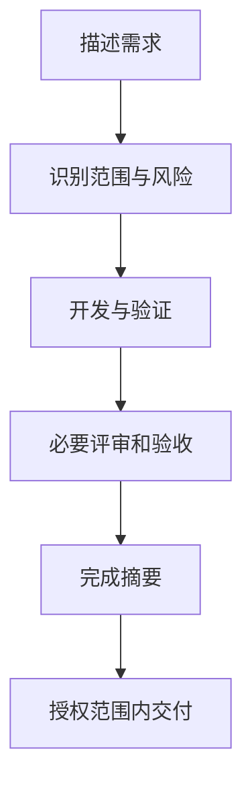

# pipeline-standard


**用对话完成需求、开发、测试和交付，同时支持 Claude Code 与 Codex。**

直接描述需求，pipeline 自动识别项目、明确验收并按风险与复杂度推进。简单任务由当前会话直做；复杂任务自动选择必要角色，并使用已配置的角色模型，不机械启动完整角色链。项目差异由智能体维护的 `PIPELINE.md` 承载，无需用户先填写配置、选择角色或学习内部命令。

## 三步开始

### 1. 安装

本机需要 Git 和 Python 3。在终端执行，或把下面的步骤交给智能体：

```bash
git clone https://github.com/wzm111/pipeline-standard.git
cd pipeline-standard
bash install.sh
```

默认同时安装 Claude Code 和 Codex；只装一端可用 `bash install.sh --claude` 或 `bash install.sh --codex`。

安装器将 skill 链接到当前仓库，并为 Claude 准备角色和 hook 链接，请保留仓库目录。首次安装会准备本机默认模型配置；重装保留已有选择。更新源码后，链接指向当前检出内容；重新执行安装器可同步新增的角色和 hook。

### 2. 在业务项目会话中描述需求

**Codex：**

```text
$pipeline 给列表增加搜索功能，并验证空结果和清空搜索的行为
```

**Claude Code：**

```text
/pipeline 给列表增加搜索功能，并验证空结果和清空搜索的行为
```

缺少项目契约时，智能体会识别项目并补齐 `PIPELINE.md`，保留已有规则；只询问无法推断且影响结果的关键信息。

### 3. 继续用自然语言操作

| 你想做什么 | Codex 示例 |
| --- | --- |
| 接入已有项目 | `$pipeline 帮我接入项目` |
| 选择角色模型 | `$pipeline 配置模型` |
| 指定一个角色 | `$pipeline 开发继承当前模型，测试让我从可用模型中选` |
| 修改本机默认 | `$pipeline 改本机默认模型` |
| 查看设置或进度 | `$pipeline 查看设置` / `$pipeline 进度怎么样` |
| 继续或修复中断 | `$pipeline 继续上次` / `$pipeline 帮我修复中断状态` |
| 提交验收成果 | `$pipeline 提交已验收的改动` |
| 发布本次改动 | `$pipeline 发布这次改动` |

Claude Code 将 `$pipeline` 换成 `/pipeline`。

**旧会话也可以继续使用更新后的 skill。** 让智能体重新读取本机最新版及本次所需引用文件，保留当前任务和有效证据，例如：

> $pipeline 请重新读取本机最新版 SKILL.md 及本次需要的引用文件，保留当前任务和有效验收证据，按最新版继续，不重复已完成的工作。

已有子角色在后续交接时同步新规则。若宿主仍未发现更新，再重启应用或新开会话；无需为每次更新重新创建项目任务。

## 需求如何推进



智能体自动选档，用户不必先选流程：

| 档位 | 适用场景 | 执行方式 |
| --- | --- | --- |
| fast | 小且明确、风险低、可定向验证的改动 | 当前会话直接实现、自测并给出精简摘要 |
| standard | 日常功能、修复和优化 | 简单任务直做；复杂开发自动派developer与独立tester，架构取舍再加planner |
| thorough | 跨系统、高风险或明确要求完整审查 | 完整规划、范围评审、开发与 QA、终验及必要人工闸口 |

用户指定的档位仍生效；发现风险可以升级，不能自行降低要求。单批测试打回最多 3 轮，范围评审最多 2 轮，到顶报告阻塞。详细规则见 [skill 入口](skills/pipeline/SKILL.md)。

复杂度依据跨模块耦合、多入口一致性、排错难度和独立验证需要判断，不只看文件数。角色复用已有上下文与有效测试证据，普通提交和摘要仍由主会话完成。进行中的任务无需停止重做，后续阶段重读规则后只安排剩余工作或独立验收。

## 如何减少重复工作

| 机制 | 实际行为 |
| --- | --- |
| 精简直通入口 | 智能体用统一 CLI 启动、检查、记录与收口，取得真实路径，不为调用接口反复读内部源码 |
| 上下文差量复用 | 已读未变的文件片段直接沿用；修改后优先核对 diff；实际交接才使用缓存基线与角色差量 |
| 有效验证复用 | 核验输入、工具环境、日志和来源；只补缺失或失效项，局部检查不冒充全量验收 |
| 验收定义一致 | 多项检查与QA使用同一份计划；增项可承接定义未变的有效检查，缺QA时提示补齐；简单检查保持原入口 |
| 浏览器前置探测 | 页面正常就绪后，首次验收也先短查目标控件；已有脚本、样本和前置条件可继续沿用 |
| 开发到发布承接 | 同一交付跨阶段保留有效证据，不因换角色或 run 就重新规划、测试和构建 |
| 发布前置与有界恢复 | 先做现场和真实运行器快检；合格候选可复用时保留产物，连续激活失败停止自动尝试 |
| 产物分层核验 | 源码传输与实际目标平台构建产物分别核验，避免跨平台生成文件误比较 |
| 单次收尾 | 必要线上身份、关键路径验收完成后复用同一份收尾报告；搜索收录等外部结果单列待确认 |

产物复用取决于项目已有的可靠构建、验收及激活接口；没有支持时保留现有部署门禁，不猜“跳过构建”参数。代码、环境、证据变化或真实缺陷仍需相应验证。

这些机制旨在减少无效操作，**不承诺固定提速或 token 降幅**。阶段、操作和角色耗时按真实记录统计，并行时段不重复相加；宿主没有提供的 token 或实际模型反馈保持未知。真实样本与验证结果见 [2026-10-28 观察记录](docs/FIELD-OPTIMIZATION-20261028.md)。

## 角色模型怎么设置

用户只需说“配置模型”“开发继承当前模型”或“改本机默认”，智能体负责校验和保存。

配置按角色选择，优先级为：**本次指定 → 项目配置 → 本机默认 → skill 模板 → 运行时默认**。

- 项目配置：项目根 `pipeline.models.json`，只覆盖该项目的相应角色。
- 本机默认：`~/.config/pipeline-standard/models.json`，安装时初始化，升级不覆盖。
- 新装模板：两端均先继承当前会话模型，避免绑定账号不支持的型号。
- Claude 与 Codex 分别保存各自的偏好；可以按任务类型选择模型，不要求两端使用相同型号。

角色配置仅在实际委派时应用，不能替用户切换当前主会话的界面模型。型号不可用时说明原因，仅按已有授权回退或让用户重选；请求参数与宿主实际反馈分开记录，不把“已请求”当成“已确认”。详见 [模型配置](skills/pipeline/references/models.md) 与 [任务路由](skills/pipeline/references/model-routing.md)。

## 双端支持与执行边界

| 运行时 | 入口 | 执行机制 |
| --- | --- | --- |
| Claude Code | `/pipeline` | 原生角色、team 协作；项目接入后可通过 `PreToolUse` hook 拦截受支持工具的越界写 |
| Codex | `$pipeline` | 子 agent 与 follow-up；按同一项目契约做写前校验，使用本地归属和检查接口 |

两端共用风险分档、验收标准、打回上限和交付证据；角色、模型参数及工具能力以宿主实际支持为准。**Codex 的流程校验不能称为 Claude 同层级的 hook 硬拦截；Bash hook 也不是完整沙箱。** 兼容情况见 [兼容矩阵](docs/COMPATIBILITY.md)。

“提交”不自动授权推送或部署；Git 写入、安装和上线动作按用户具体指令或项目契约执行，已有授权不要求重复填写配置。同项目只运行一条流水线；中断后让智能体核对执行者和归属，不自行删除未知锁。

没有可用子 agent/hook 的工具可参考 [单 agent 便携模板](templates/single-agent-pipeline.md)，按需串行执行，不能宣称具备原生角色隔离或 hook 能力。

## 进阶与维护

下面的路径供智能体或维护者排查，日常使用无需手工操作：

| 需要了解什么 | 入口 |
| --- | --- |
| 流程与直通命令 | [SKILL.md](skills/pipeline/SKILL.md)、[standard](skills/pipeline/references/standard.md) |
| 项目接入 | [对话接入](skills/pipeline/references/interaction.md)、[init-project.sh](init-project.sh) |
| 检查证据与发布 | [检查计划](skills/pipeline/references/check-plan.md)、[证据复用](skills/pipeline/references/evidence.md)、[交付承接](skills/pipeline/references/delivery.md) |
| 状态与中断恢复 | [运行接口](skills/pipeline/references/operations.md) |
| 工具按需准备 | [工具说明](tools/quick-install.md) |
| 版本与建设进度 | [发布说明](docs/releases/)、[实施记录](docs/IMPLEMENTATION.md)、[路线图](docs/ROADMAP.md) |

中间产物由智能体维护在 `tmp/pipeline/`；有 Python 时按 `runs/<run_id>.json` 与该 run 的报告保存，CLI 私有 receipt 不公开。`state.md` 仅为旧格式，不与新状态并行维护。规划项、源码中的后续改进与已发布标签分开，以实际安装的检出内容为准。

维护者可运行 `bash tests/run-all.sh` 做本地隔离回归；真实模型应用、业务项目提速和 token 对照需要另外的实际证据，单元测试不能替代。

## License

MIT
