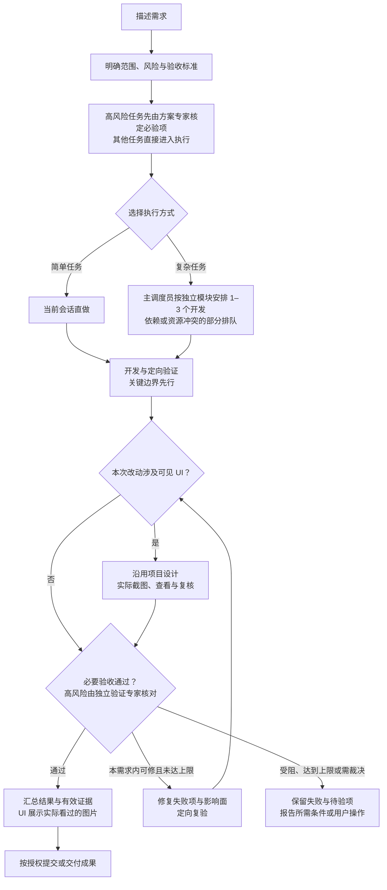
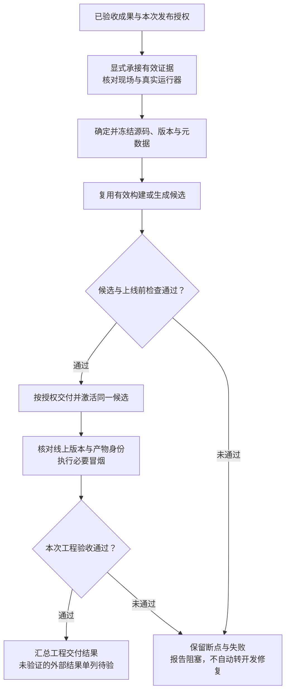

# pipeline-standard

[English](docs/README.en.md) · 简体中文


[](https://github.com/wzm111/pipeline-standard/actions/workflows/test.yml)

**用对话完成需求、开发、测试和交付，支持 Claude Code 与 Codex。**

pipeline 是一套由编码智能体执行的 skill 和本地工具。你描述需求，智能体明确范围与验收标准，按复杂度选择直接实现或必要的角色协作，并记录可核验的执行证据。项目差异由智能体维护的 `PIPELINE.md` 承载，无需先填写配置、选择流程档位或学习内部命令。

- **控制范围**：只做当前需求和必要配套，发现无关问题先记录。
- **看清过程**：展示当前动作、有效结果、剩余步骤和阻塞，区分执行结束与交付完成。
- **复用证据**：输入、环境、日志和来源仍有效时复用检查，保留必要复测。
- **视觉自查**：页面任务沿用项目设计，记录实际截图、查看与复核；缺少真实观察时保留待验。
- **本地诊断**：运行记录可在本地预览，诊断模块不自动上传报告。

[快速试用](docs/TRY-PIPELINE.md) · [稳定版 v3.13.0](https://github.com/wzm111/pipeline-standard/releases/tag/v3.13.0) · [main 开发更新](docs/releases/UNRELEASED.md)

## 三步开始

### 1. 安装

本机需要 Git 和 Python 3；仓库 CI 使用 Python 3.11。在终端执行，或让智能体协助安装：

```bash
git clone https://github.com/wzm111/pipeline-standard.git
cd pipeline-standard
bash install.sh
```

默认同时安装 Claude Code 和 Codex；仅安装一端可用 `bash install.sh --claude` 或 `bash install.sh --codex`。

安装器将 skill 链接到当前仓库，并为 Claude 准备角色和 hook 链接，请保留仓库目录。首次安装准备本机默认模型配置；重装保留已有选择。上述命令安装当前默认分支的内容，需要固定版本时可让智能体切换到指定发布标签。

当前推荐完整仓库安装：`agents/`、`hooks/`、模板和脚本共同组成工具。只复制 `SKILL.md` 或 `skills/pipeline/` 不能视为完整安装；第三方目录的一键安装、官方插件商店上架尚未作为已验证能力提供。

### 2. 在业务项目会话中描述需求

**Codex：**

```text
$pipeline 给列表增加搜索功能，并验证空结果和清空搜索的行为
```

**Claude Code：**

```text
/pipeline 给列表增加搜索功能，并验证空结果和清空搜索的行为
```

缺少项目契约时，智能体识别项目并补齐 `PIPELINE.md`，保留已有规则；只询问无法推断且影响结果的关键信息。每个需求只做当前目标及必要配套，无关问题不自动加入开发或验收。

### 3. 用自然语言继续

| 你想做什么 | Codex 示例 |
| --- | --- |
| 梳理需求 | `$pipeline 梳理批量核销需求，先讨论，不改代码` |
| 整理方案 | `$pipeline 把已确认的方案保存为本地文档，列出验收条件` |
| 拆分任务 | `$pipeline 按可独立验收的业务结果拆分方案，标明依赖` |
| 按方案开发 | `$pipeline 完成任务 03，本轮先验证，暂不提交` |
| 审查代码 | `$pipeline 审查从 <SHA> 到 HEAD 的改动，需求见 <路径>，只报告问题` |
| 查看具体步骤 | `$pipeline 列出已完成、正在执行、剩余步骤和阻塞` |
| 继续原任务 | `$pipeline 继续上次任务，复用仍有效的检查` |
| 配置角色模型 | `$pipeline 开发继承当前模型，测试使用……` |
| 查看设置 | `$pipeline 查看当前模型设置` |
| 接入已有项目 | `$pipeline 帮我接入项目` |
| 提交验收成果 | `$pipeline 提交已验收的改动` |
| 发布本次改动 | `$pipeline 发布这次已验收的改动` |
| 分析运行开销 | `$pipeline 扫描本项目的运行记录，找可优化点` |

Claude Code 将 `$pipeline` 换成 `/pipeline`。**提交、推送和发布按各自授权执行**；一次提交授权不会扩大为部署或修改其他项目。

## 执行时能看到什么

主会话在开始、阶段切换、重要检查结果和阻塞出现时反馈具体步骤。长操作通常每 60 至 90 秒给出有依据的简报；宿主长调用尚未返回时，不能保证实时推送。

例如，测试阶段的进度可以是：

> 🔵 **[进行中｜测试]** 当前：验证重新登录后的状态恢复。已完成：超时取消快检。
>
> 剩余：缓存刷新验证、完整回归。阻塞：无。下一步：根据定向验证结果进入完整回归。

| 标识 | 含义 |
| --- | --- |
| 🔵 **[进行中]** | 有实际动作或反馈依据，正在开发、测试、构建或审查 |
| ✅ **[已完成]** | 某个明确步骤已有成功结果，不代表整个交付完成 |
| 🟠 **[修复中]** | 正在修复已确认的问题，并说明随后要补的检查 |
| ⏳ **[等待中]** | 等待具体命令、角色或外部结果 |
| 🔴 **[需你处理]** | 必须由用户操作，并给出恢复后的验证标准 |
| 🔎 **[待核实]** | 反馈不足或状态冲突，不能直接判断正常或卡死 |

v3.11.0 提供只读 `progress` 摘要，整理当前任务、检查与角色、登记成功项、剩余项、阻塞和下一步，并区分最近结果时间与状态更新时间。登记成功不等于证据当前仍有效；`running` 也不单独证明宿主健康。没有记录的步骤、耗时或实际模型保持未知，不编造百分比或 ETA。

**进度脚本不会自行发送聊天消息，需由实际执行会话采用。** 旁观监听默认只报有意义的变化，不能代替执行者的过程反馈。目前没有逐条聊天消息的发送前校验或自动纠正；读取 skill 或确认规则版本不能证明每条反馈已合规。格式和调用方式见[可见进度规范](skills/pipeline/references/progress.md)；监听边界见[只读监控](skills/pipeline/references/monitoring.md)。

## 需求如何推进

按本次目标选择入口：简单任务直接开发验证；复杂任务按需协作；已验收成果直接提交发布。下图是开发与修复闭环，阶段切换不重复规划或审查，交付继续保留必要门禁。



| 档位 | 适用场景 | 执行方式 |
| --- | --- | --- |
| fast | 范围明确、低风险、可定向验证的小改动 | 当前会话直接实现和自测 |
| standard | 日常功能、修复和优化 | 简单任务直做；主调度员按需安排 1–3 个开发与独立 tester |
| thorough | 跨系统、高风险或明确要求完整审查 | 完整规划、范围评审、开发、QA 与必要人工闸口 |

智能体自动选档；用户指定的档位仍生效，发现风险可以升级，不能自行降低要求。复杂度看模块耦合、多入口一致性和验证需要，不只看文件数。单批测试打回最多 3 轮，范围评审最多 2 轮，到顶停报。纯发布门禁失败时报告阻塞，不自动扩展为开发修复。

高风险任务由方案专家和独立验证专家共用一份必验清单。前者在开发前查影响范围和遗漏，后者在候选冻结后核对当前证据。打回后只复验修复项及影响范围。详见[双专家评审](skills/pipeline/references/review.md)。

常规成功结果可用精简返回，完整证据留在本地报告；失败与阻塞仍完整展示。必要独立QA保留，有效的同版检查和审查继续复用。

### 最多三个开发并行

由现有主调度员决定是否并行、开几个开发及每人的写入范围，不新增拍板角色、不默认开满。同一需求按独立模块分工，共享文件指定一人负责；有接口依赖或资源冲突的部分排队。开发分别完成定向检查，产物合并冻结后复用有效证据，统一做必要终验、提交和发布。

任务开始或范围实质变化时主动评估，不等用户提醒。进度会说明分工或串行原因，并区分计划、已请求、宿主接受与返回；计划记录不等于子智能体已经启动。

遇到反复阻塞时，可按需请现有专家角色做短诊断：先定向修复，复测仍失败或根因判断冲突才介入；同根因最多一次，每任务最多两次，精简交接内容，不新增常驻观察者，也不改变原验收上限。

同一run最多3个已登记的开发名额，待接受的派发也占位；真实完成后释放并可续用。QA独立于开发，按宿主空闲名额安排：主会话也占并发名额，若宿主总容量为4，开满3个开发时QA需等开发返回。派发门禁不能证明宿主实际容量，也不拦截未接入的原生调用。

### 页面任务的视觉验收

智能体先查看受影响页面、现有样式与组件，采用适用且已可用的设计 skill；不可用时执行内置设计检查，不要求用户先提供截图或安装工具。验收覆盖本次目标所需的真实视口、状态、版本及完整输入依赖。

实际截图、实际查看和实际复核分别记录。源码或图片变化后的旧结论失效，修复后重新查看受影响表面；小改动可自查，较大或重要页面按风险复用 tester 独立复核。最终回复展示看过的图片和未验证限制。没有浏览器、截图或所需状态时保留待验，不以构建或 DOM 检查代替视觉通过。

已声明 UI 要求接入管理型 QA 与收口门禁；**机器核验证据绑定与完整性，审美判断仍由实际观察者作出**。它不自动识别任意未声明 UI，也不证明模型实际看懂了界面。详见[视觉验收](skills/pipeline/references/visual.md)，可用[合成页面示例](docs/TRY-PIPELINE.md)独立试用。

### 已验收成果如何发布

仅提交时按授权选择文件并提交，不执行下方发布步骤。需要发布时，先复用仍有效的成果和证据，补必要现场检查。下图展示支持候选与激活分离的路径；单体发布脚本按项目实际能力执行并记录整体结果，不宣称已拆成独立阶段。



发布候选终验后不补改版本，也不在激活时暗中重建候选；变更后补相应验证。断连或中断先核对原执行与已激活状态。HTTP 成功、上传完成与实际平台验收分别判断。详见[交付承接](skills/pipeline/references/delivery.md)。

### 哪些规范由工具校验

管理型运行通过已接入的脚本入口确认当前规则版本、核验真实检查证据，并在收口时复核完整性。不能仅写一份 PASS 报告代替验收；输入、环境、日志或后续失败使旧证据失效时，不能继续放行。旧运行保留兼容，但不能据此认定已采用新规则。

规则确认只记录调用方声明，不证明模型已理解或执行了所有文字规范。聊天反馈、范围判断及原生工具调用仍需智能体遵守；已接入入口的门禁不等于能拦截任意 shell 或宿主操作。详见 [skill 入口](skills/pipeline/SKILL.md)与[双端兼容说明](docs/COMPATIBILITY.md)。

## 如何减少重复工作

| 做法 | 实际行为 |
| --- | --- |
| 先查关键边界 | 已声明的 quick 检查须有效，才运行重型终验；保留必要完整回归 |
| 纳入原生工具证据 | 多项浏览器检查用实际观察引用进入同一计划，复核已有证据，不虚构命令或新一次执行 |
| 复用有效证据 | 核对命令、目录、输入、环境、日志和来源，只补失效或缺失项 |
| 减少交接漂移 | 角色续用已有上下文；同进程完成检查、QA 与可选封存，收口前先查停止和等待条件 |
| 保留真实阶段 | 显式绑定的主流程角色在宿主接受后同步阶段；所选角色全部返回后再交接 |
| 承接已验收交付 | 提交或发布沿用同一成果；必要现场预检、产物身份和上线冒烟仍执行 |
| 有界处理异常 | 断连先核对原执行和候选状态，不盲目重部署；必须人工操作时保留具体待办 |

角色并行不能相互覆盖构建目录、浏览器或其他共享资源。源码、依赖、环境、产物或目标状态变化后的必要复测保留；没有可靠复用入口时，不猜“跳过构建”参数。

这些机制不承诺固定提速或 token 降幅。实现与本地测试通过，不等于其他会话已采用，也不等于业务项目已获得同样收益。已有真实观察见 [2026-10-28 记录](docs/FIELD-OPTIMIZATION-20261028.md)；检查与交付规则见[检查计划](skills/pipeline/references/check-plan.md)和[交付承接](skills/pipeline/references/delivery.md)。

## 运行日志与后续优化

经本地状态接口执行时，在启动、恢复和结束等生命周期节点写入 `tmp/pipeline/runs/<run_id>/audit.json` 安全摘要。原状态和检查证据保留在对应 run 目录；未接入的历史任务或原生调用不能假定已自动采集。

摘要记录阶段与等待、检查执行/复用/继承、失败分类及任务和角色统计。v3.11.0 增加按任务划分的耗时摘要：检查、操作和等待区间取并集，不把并行时间重复相加；**未归因时间不等于浪费或排队**。未知模型、token 和缺失历史保持未知。

可直接说“预览本项目的运行报告”，由智能体调用只读 `preview` 展示本地技术摘要；默认查看当前run或最近记录，并标明快照过期、缺失和未知项。诊断功能仅在本地记录与预览，不包含网络上报、GitHub提交或自动上传配置。

也可在本地终端执行预览命令。由聊天智能体展示时，预览文本可能进入当前对话，数据处理遵循宿主规则；诊断模块不联网不代表整个宿主离线。

分析时也可用只读 `scan` / `audit`，默认不打开原始业务日志、不修改历史、不重跑检查。安全摘要不保存凭据、用户目标正文、客户数据或环境原文；原始输出仍需项目自身脱敏。摘要仅供诊断，不是 QA、复用或发布凭证。详见[运行记录](skills/pipeline/references/audit.md)。

记录默认不提交 Git；清理 `tmp/pipeline/` 会删除本地记录。长期归档只保留已确认脱敏的摘要，不打包整个运行目录。

## 跨 Agent 接手同一任务


在同一项目或 worktree 切换 Agent 时，把项目目录和 run ID 告诉接手者。Pipeline 在执行时自动保存已登记的阶段、任务、下一步和证据引用。原 Agent 突然停用时，接手者仍可用 `handoff-read` 读取这些事实。关键决策及原因由当前主调度员用 `handoff-save` 按需补记，建议摘要约 8 KiB，长背景按主题放入详情。

新 Agent 用 `handoff-read` 查看分支、提交、未提交改动、当前任务和在途工作，有手动快照时比较工作区变化，再按需读取详情、文件与证据。仍在进行的检查或发布先核对原结果。继续操作沿用原项目规则和已授权的运行归属。可运行 Python 并访问同一工作区的宿主均可读取交接。 [交接命令与恢复规则](skills/pipeline/references/operations.md)

## 角色模型与运行边界

模型优先级为：**本次指定 → 项目配置 → 本机默认 → skill 模板 → 运行时默认**。

- 项目配置为 `pipeline.models.json`；本机默认位于 `~/.config/pipeline-standard/models.json`，升级保留已有选择。
- 新装模板先继承当前会话模型；Claude 与 Codex 可分别设置，也可按任务类型路由。
- 配置只在实际委派时应用，不能切换当前主会话的界面模型；请求参数不等于宿主确认的实际型号。

详见[模型设置](skills/pipeline/references/models.md)和[任务路由](skills/pipeline/references/model-routing.md)。

| 运行时 | 入口 | 执行边界 |
| --- | --- | --- |
| Claude Code | `/pipeline` | 原生角色与 team；项目接入后可通过 `PreToolUse` hook 拦截受支持工具的越界写 |
| Codex | `$pipeline` | 子 agent 与 follow-up；按项目契约做写前校验，使用本地归属和检查接口 |

Codex 的流程校验不能称为与 Claude 同层级的 hook 硬拦截，Bash hook 也不是完整沙箱。没有原生子 agent/hook 的工具可参考[单 agent 模板](templates/single-agent-pipeline.md)，不能宣称具备角色隔离。同项目只运行一条流水线，中断后先核对执行者和归属，不自行删除未知锁。

## 更新与已有会话

更新仓库后，已安装的软链接指向新的检出内容；需要同步新增角色或 hook 时再运行安装器。本机模型选择不会因重装被覆盖。

已有会话不会自动刷新上下文，可让执行者：

> $pipeline 请重新读取本机最新版 SKILL.md 及本次需要的引用文件，保留当前任务和有效验收证据，按最新版继续，显示具体步骤，不重复已完成的工作。

已有子角色在后续交接时同步新规则。若宿主仍未发现 skill 更新，再重启应用或新开会话；无需为每次更新重新创建任务。

## 维护入口

| 需要了解什么 | 入口 |
| --- | --- |
| 流程与直通命令 | [SKILL.md](skills/pipeline/SKILL.md)、[standard](skills/pipeline/references/standard.md) |
| 项目接入 | [对话接入](skills/pipeline/references/interaction.md)、[init-project.sh](init-project.sh) |
| 证据与浏览器验收 | [证据复用](skills/pipeline/references/evidence.md)、[浏览器交接](skills/pipeline/references/browser-handoff.md)、[视觉验收](skills/pipeline/references/visual.md) |
| 状态与中断恢复 | [运行接口](skills/pipeline/references/operations.md) |
| 进度与安全摘要 | [进度规范](skills/pipeline/references/progress.md)、[运行记录](skills/pipeline/references/audit.md) |
| 安装与分发 | [安装与分发说明](docs/DISTRIBUTION.md) |
| 版本与建设进度 | [发布说明](docs/releases/)、[实施记录](docs/IMPLEMENTATION.md)、[路线图](docs/ROADMAP.md) |

维护者在仓库根目录运行 `bash tests/run-all.sh` 做本地隔离回归。真实模型、业务验收和实际提速需要对应环境的证据，本地测试不能替代。

## License

MIT
