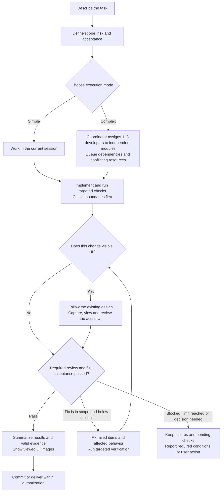
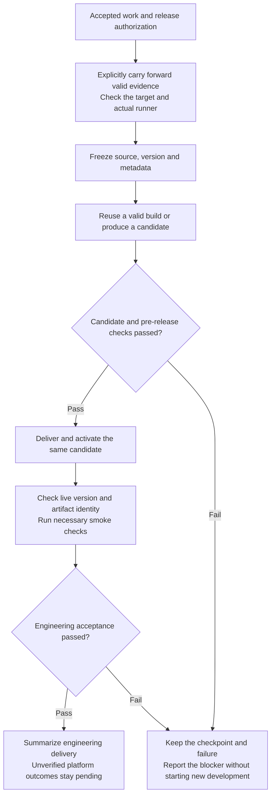

# pipeline-standard

English · [简体中文](../README.md)

[](https://github.com/wzm111/pipeline-standard/actions/workflows/test.yml)
[](../LICENSE)

**A conversational development workflow for Claude Code and Codex: bounded scope, visible progress, and verifiable delivery evidence.**

Describe a task in your coding-agent session. Pipeline helps the agent define scope and acceptance, implement the change, run appropriate checks, and summarize the result. Small tasks stay in the current session; complex work uses the necessary roles. The agent maintains a project-specific `PIPELINE.md` contract.

- **Bounded scope:** unrelated findings are recorded instead of becoming extra development work.
- **Visible progress:** see the current action, last meaningful result, remaining steps, and blockers.
- **Evidence-aware checks:** reuse results only while command, working directory, inputs, environment, logs, and provenance remain valid.
- **Visual inspection:** UI work follows the existing design and records actual screenshots, viewing, and review. Missing observations remain pending.
- **Local diagnostics:** preview local run records without an automatic report-upload service.

Use it for feature work, fixes with meaningful acceptance checks, and development-to-release handoffs. For a one-line edit or a simple query, a direct agent request may be sufficient. No fixed speedup or token reduction is promised.

[Quick example](TRY-PIPELINE.md) · [Updates](releases/UNRELEASED.md)

## Install the complete repository

Requirements: Git, Python 3, and an existing Claude Code or Codex installation. Repository CI runs on Ubuntu and macOS with Python 3.11. The installer uses Bash and symbolic links; native Windows installation is not claimed here.

```bash
git clone https://github.com/wzm111/pipeline-standard.git
cd pipeline-standard
bash install.sh
```

Install only one runtime with `bash install.sh --codex` or `bash install.sh --claude`. These commands install the current default branch. For a fixed release, clone with `--branch v3.13.0 --depth 1` instead.

Review the installer before running it. It creates skill links and local model defaults; for Claude Code it also links agents and hooks. Keep the checkout at its installed location. Existing model choices are preserved on reinstall. Hook activation for a project is part of project setup, not a promise that every host operation is intercepted.

This package depends on resources outside the skill folder. Copying only `SKILL.md` or `skills/pipeline/` is not a complete installation. See [distribution status](DISTRIBUTION.md) before advertising third-party one-command installation.

## Try a task

In a Codex project session:

```text
$pipeline Add search to the list. Verify empty results and clearing the search. Keep this task scoped to the affected list and tests.
```

In Claude Code, use `/pipeline` with the same request.

For a reproducible starting point, follow the [isolated walkthrough](TRY-PIPELINE.md#english), which also includes a synthetic UI task. No business account or production data is required.

Continue naturally:

| Goal | Example |
| --- | --- |
| See progress | `$pipeline Show completed, current, remaining steps and blockers.` |
| Resume | `$pipeline Continue the last task and reuse checks that are still valid.` |
| Inspect local records | `$pipeline Preview this project's local run report.` |
| Commit | `$pipeline Commit the accepted changes.` |

Commit, push, and release permissions are distinct. The workflow does not turn a commit request into permission to deploy or modify another project.

## How development proceeds

The diagram covers development and fixes. Committing or releasing accepted work reuses valid evidence rather than restarting development.



Small, low-risk tasks use fast mode in the current session. Standard mode uses only the roles needed for the task; thorough mode covers high-risk work and required human gates. Testing allows at most three rejection rounds per batch; scope review allows two. Reaching a limit stops the loop. A release failure does not automatically authorize development fixes.

### Up to three parallel developers

The existing coordinator decides whether to use one, two, or three developers and assigns each write scope. There is no extra approval role and no requirement to fill all slots. Shared files have one owner; dependent work and conflicting resources are queued. Developers run focused checks, then the coordinator combines frozen results, reuses valid evidence, and performs necessary final verification, commits, and releases.

A run reserves at most three developer dispatch slots, including pending dispatches. A slot is released only after confirmed completion. Independent QA starts when frozen work and host capacity are available. The main session also uses a slot: with four total host slots, three developers leave no room for QA until a developer returns. The dispatch guard covers integrated records; it does not prove host capacity or intercept every native call.

UI tasks use an applicable design skill already available in the host, or the built-in design checks. Existing project styles and components remain the baseline. The agent declares the required surfaces, viewports, states, version and complete inputs; it then records actual screenshots, viewing and review. Changes invalidate affected old evidence. Small changes can be self-reviewed; important or substantial changes use proportionate independent review. The final response shows actual viewed images and unverified limitations.

Declared UI requirements participate in managed QA and completion checks. **Tools validate evidence bindings and completeness; aesthetic judgment remains the actual observer's responsibility.** Missing browser access, images or required states remain pending. Builds and DOM checks alone do not establish visual acceptance. See [visual acceptance](../skills/pipeline/references/visual.md).

## How accepted work is released

A commit-only request does not run deployment steps. For releases, reuse valid evidence and perform necessary target-environment checks. The diagram describes projects that separate candidate creation from activation. Monolithic project scripts retain their actual execution boundaries.



Do not change version metadata after final candidate acceptance or silently rebuild during activation. Revalidate affected evidence after changes. After interruptions, check the original execution and activation state before retrying. HTTP success, upload completion and downstream platform acceptance are separate results. Multiple native browser checks can join the same [check plan](../skills/pipeline/references/check-plan.md) through exact observed references without fabricated shell commands or new execution time. See [delivery handoffs](../skills/pipeline/references/delivery.md).

## What you can verify

The tools validate evidence at integrated entry points and retain failed checks. A rule acknowledgement does not prove that a model understood every instruction. Registered `running` state alone does not prove host health. A successful test does not prove deployment or downstream platform acceptance.

Progress scripts produce read-only summaries; the executing agent must actually send them in the conversation. Long host calls can delay visible updates. Read-only monitoring does not replace the executor's progress updates, and there is no per-message send-time validator or automatic correction. Loading the skill or acknowledging a revision does not prove message-format compliance. Claude hooks and Codex's workflow checks have different enforcement boundaries; neither is described as a complete sandbox.

Diagnostics are recorded under the project's ignored `tmp/pipeline/` directory. Preview output is restricted to technical metadata; raw logs and private ownership files are not public reporting artifacts. When an agent displays a preview in chat, that text is handled under the host's data policy. Local diagnostic code does not make the whole host offline.

## Releases and details

Version status and known limitations are listed in the [update notes](releases/UNRELEASED.md). The complete Chinese guide covers [project setup](../skills/pipeline/references/interaction.md), [check plans](../skills/pipeline/references/check-plan.md), [delivery](../skills/pipeline/references/delivery.md), and [local records](../skills/pipeline/references/audit.md).

Maintainers run `bash tests/run-all.sh` from the repository root. Local tests and CI are implementation evidence; actual project adoption and performance require separate measurements.

## Feedback

Use [GitHub Issues](https://github.com/wzm111/pipeline-standard/issues) for questions and reproducible failures. Include the runtime, operating system, version, expected behavior, and a minimal synthetic reproduction. Reports are voluntary. Do not paste private project logs, credentials, customer data, or the entire `tmp/pipeline/` directory.

## License

[MIT](../LICENSE).
