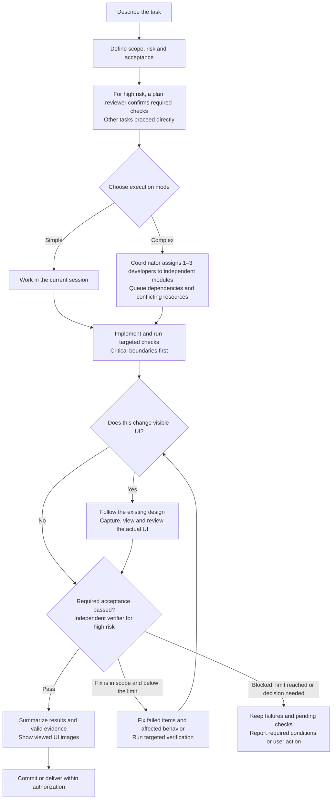
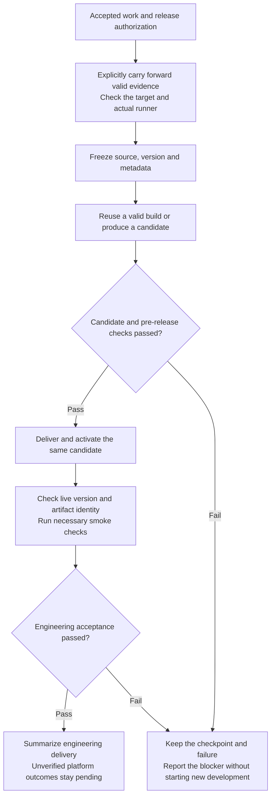
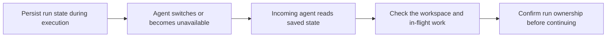

# pipeline-standard

English · [简体中文](../README.md)

[](https://github.com/wzm111/pipeline-standard/actions/workflows/test.yml)
[](../LICENSE)

**A conversational development workflow for Claude Code and Codex: bounded scope, visible progress, and verifiable delivery evidence.**

Describe a task in your coding-agent session. Pipeline helps the agent define scope and acceptance, implement the change, run appropriate checks, and summarize the result. Small tasks stay in the current session; complex work uses the necessary roles. The agent maintains a project-specific `PIPELINE.md` contract.

- **Bounded scope:** unrelated findings are recorded instead of becoming extra development work.
- **Visible progress:** see the current action, last meaningful result, remaining steps, and blockers.
- **Evidence-aware checks:** reuse results only while command, working directory, inputs, environment, logs, and provenance remain valid.
- **Visual inspection:** UI work follows the existing design and records actual screenshots, viewing, and review. Missing observations remain pending.
- **Local diagnostics:** preview local run records without an automatic report-upload service.

Use it for feature work, fixes with meaningful acceptance checks, and development-to-release handoffs. For a one-line edit or a simple query, a direct agent request may be sufficient. No fixed speedup or token reduction is promised.

[Quick example](TRY-PIPELINE.md) · [Stable v3.13.0](https://github.com/wzm111/pipeline-standard/releases/tag/v3.13.0) · [Prerelease v3.14.0-rc.1](releases/v3.14.0-rc.1.md)

## Get started

Requirements: Git, Python 3, and an existing Claude Code or Codex installation. Repository CI runs on Ubuntu and macOS with Python 3.11. The installer uses Bash and symbolic links; native Windows installation is not claimed here.

```bash
git clone https://github.com/wzm111/pipeline-standard.git
cd pipeline-standard
bash install.sh
```

Install only one runtime with `bash install.sh --codex` or `bash install.sh --claude`. These commands install the current default branch. For a fixed release, clone with `--branch v3.13.0 --depth 1` instead.

Review the installer before running it. It creates skill links and local model defaults; for Claude Code it also links agents and hooks. Keep the checkout at its installed location. Existing model choices are preserved on reinstall. Hook activation for a project is part of project setup, not a promise that every host operation is intercepted.

This package depends on resources outside the skill folder. Copying only `SKILL.md` or `skills/pipeline/` is not a complete installation. See [distribution status](DISTRIBUTION.md) before advertising third-party one-command installation.

### Try a task

In a Codex project session:

```text
$pipeline Add search to the list. Verify empty results and clearing the search. Keep this task scoped to the affected list and tests.
```

In Claude Code, use `/pipeline` with the same request.

For a reproducible starting point, follow the [isolated walkthrough](TRY-PIPELINE.md#english), which also includes a synthetic UI task. No business account or production data is required.

Continue naturally:

| Goal | Example |
| --- | --- |
| Clarify requirements | `$pipeline Clarify the batch reconciliation requirements. Discuss only.` |
| Write a spec | `$pipeline Save the agreed spec and acceptance criteria in a local document.` |
| Break down work | `$pipeline Split the spec into independently verifiable outcomes and list dependencies.` |
| Implement one task | `$pipeline Implement and verify task 03. Stop before committing.` |
| Review code | `$pipeline Review changes from <SHA> to HEAD against <spec path>. Report findings only.` |
| Verify a feature request | `$pipeline Check whether <issue link> is already covered. Report applicable versions, activation conditions, and gaps.` |
| See progress | `$pipeline Show completed, current, remaining steps and blockers.` |
| Resume | `$pipeline Continue the last task and reuse checks that are still valid.` |
| Inspect local records | `$pipeline Preview this project's local run report.` |
| Commit | `$pipeline Commit the accepted changes.` |

Commit, push, and release permissions are distinct. The workflow does not turn a commit request into permission to deploy or modify another project.

## What you can see during a run

The executing agent reports the current action, the latest confirmed result, and the next step or blocker. Ask “What is done, and what remains?” The agent sends progress in the conversation. See the [progress guide](../skills/pipeline/references/progress.md).

## How development proceeds

Choose an entry for the current goal: implement and verify a simple task directly, delegate independent work when needed, or deliver already accepted work. The diagram covers development and fixes; phase changes do not repeat planning or review, and delivery retains its required gates.



Simple tasks can run in the current conversation. Complex tasks can use up to three developers for independent work. High-risk tasks use [separate plan and verification reviews](../skills/pipeline/references/review.md). UI changes include [visual inspection of the actual interface](../skills/pipeline/references/visual.md).

## How accepted work is released

A commit-only request does not run deployment steps. For releases, reuse valid evidence and perform necessary target-environment checks. The diagram describes projects that separate candidate creation from activation. Monolithic project scripts retain their actual execution boundaries.



Do not change version metadata after final candidate acceptance or silently rebuild during activation. Revalidate affected evidence after changes. After interruptions, check the original execution and activation state before retrying. HTTP success, upload completion and downstream platform acceptance are separate results. Multiple native browser checks can join the same [check plan](../skills/pipeline/references/check-plan.md) through exact observed references without fabricated shell commands or new execution time. See [delivery handoffs](../skills/pipeline/references/delivery.md).

## Hand a task to another agent



When switching agents in the same project or worktree, give the incoming agent the project path and run ID. Use `handoff-read` to inspect the saved task, workspace, and evidence references. Check any work still in flight before continuing under the existing authorization. See [handoff and recovery](../skills/pipeline/references/operations.md).

## Releases and details

- [Stable v3.13.0](https://github.com/wzm111/pipeline-standard/releases/tag/v3.13.0) · [Main branch updates](releases/UNRELEASED.md) · [Installation, updates, and distribution](DISTRIBUTION.md)
- [Project setup](../skills/pipeline/references/interaction.md) · [Roles and models](../skills/pipeline/references/models.md) · [Host compatibility and enforcement](COMPATIBILITY.md)
- [Check plans](../skills/pipeline/references/check-plan.md) · [Evidence reuse](../skills/pipeline/references/evidence.md) · [Local records and previews](../skills/pipeline/references/audit.md)
- [Implementation and maintenance](IMPLEMENTATION.md) · [Roadmap](ROADMAP.md)

After updating, ask an existing conversation to reread the current skill and relevant references while retaining the current task and any still-valid evidence.

## Feedback

Use [GitHub Issues](https://github.com/wzm111/pipeline-standard/issues) for questions and reproducible failures. Include the runtime, operating system, version, expected behavior, and a minimal synthetic reproduction. Reports are voluntary. Do not paste private project logs, credentials, customer data, or the entire `tmp/pipeline/` directory.

## License

[MIT](../LICENSE).
